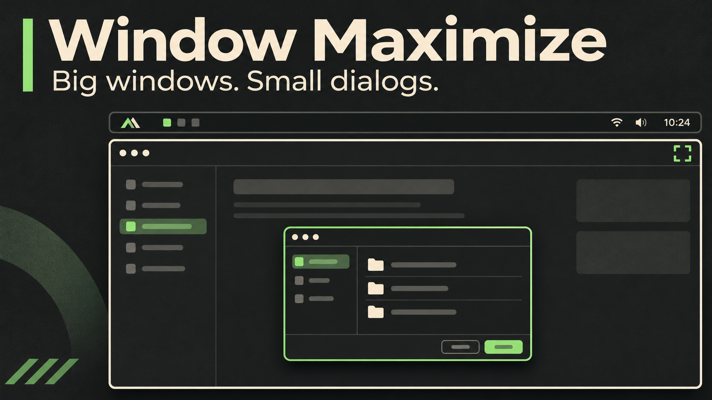

# Window Maximize Plugin (`io.github.meysamkay.window-maximize`)



A status bar widget, keyboard dispatcher, and window rules package for **Omarchy / Hyprland** to maximize and restore windows cleanly while ensuring dialogs and popups float properly.

## Why Maximize Instead of Full Screen?

In Hyprland, standard full screen (`SUPER + F` / exclusive fullscreen):
- Eliminates window margins and covers the Omarchy bar completely.
- Forces applications into exclusive Wayland fullscreen mode (`fullscreen 2`).
- **The Issue**: Many applications (Chromium/Google Chrome, Electron apps, GTK file choosers, LibreOffice, GIMP, etc.) fail to display modal dialogs—such as "Open File...", "Save As...", or prompt popups—because the modal dialog renders invisibly behind the fullscreen surface or fails to map.

**Window Maximize** (`fullscreen 1` / `mode = "maximized"`):
- Expands the window to fill the entire working screen layout (just like when only one window is open on a workspace).
- Preserves the Omarchy top bar and monitor gaps.
- Modal dialogs, file pickers, and child windows render properly on top as floating windows.

## Features

- **Bar Widget**: Displays a clean maximize icon (`󰖯`) when normal, and turns into an active restore icon (`󰖱`) when the window is maximized.
- **Interactive**:
  - **Left-click**: Toggle maximize / restore.
  - **Right-click / Middle-click**: Restore to normal tiled layout.
  - **Hover Tooltip**: Shows current action ("Maximize window", "Restore window", "Exit full screen to maximize").
- **CLI & Shortcut Ready**: Ships with `omarchy-window-maximize` CLI script in `~/.local/bin/`.
- **Modal Dialog Rules (`rules.lua`)**: Ships with automated window rules that force all modal popups, file pickers, and alerts to float centered over the active window.

## Keybinding Setup

Toggle window maximization with **`SUPER + ALT + F`** (press once to maximize, press again to restore to its original tiled size).

Add to `~/.config/hypr/bindings.lua`:

```lua
-- Maximize window (preserves gaps, top bar, and allows modal dialogs to display)
o.rebind("SUPER + ALT + F", "Maximize window", "omarchy-window-maximize toggle")
```

## Modal Dialog Floating Rules

The plugin includes `rules.lua` to ensure modal popups and file dialogs float centered directly in front of the window.

To enable them, add this one-liner to the bottom of `~/.config/hypr/hyprland.lua`:

```lua
-- Window Maximize plugin: load modal dialog floating rules
do local path = os.getenv("HOME") .. "/.config/omarchy/plugins/io.github.meysamkay.window-maximize/rules.lua"; local file = io.open(path, "r"); if file then file:close(); dofile(path) end end
```

Dialogs are centered over the previously focused app (preferring a window from the same process). Their initial size is capped at 80% of the app's width and height, up to 1100 × 800 pixels. Smaller dialogs keep their requested size. Without an identifiable owner, they open centered on their monitor with a smaller size cap.

Dialog maximize/fullscreen requests are suppressed. The plugin snapshots the focused parent's maximized state before the dialog maps and preserves it when the child opens. The dialog is placed before receiving focus, then raised above the app without moving the pointer. Opening does not reset the parent's fullscreen state; the parent-state restoration is only a fallback. Closing the child leaves the parent's maximized state and geometry unchanged.

Both modal dialogs and common Open/Save/Import/Export file chooser titles are supported, including Qt's plain “Open” title and descriptive titles such as “Choose CalculiX working directory” that do not advertise a modal role. These rules apply when a dialog opens; close and reopen an existing dialog after updating. Application minimum sizes can limit how small a dialog can become.

Keep the `dofile` loader above instead of pasting just the window rules: `rules.lua` also installs the callback that sizes and positions dialogs relative to the app window.

## Installation

Install directly through the Omarchy shell plugin manager:

```bash
omarchy plugin add https://github.com/meysamkay/omarchy-window-maximize.git --enable
```

## Removal

To remove the plugin:

```bash
omarchy plugin remove io.github.meysamkay.window-maximize
```

## Dependencies

- Omarchy Quattro shell (`quickshell`)
- Hyprland compositor
- `jq` (standard in Omarchy)
- No root or elevated privileges required.

## License

MIT License. See [LICENSE](LICENSE) for details.
